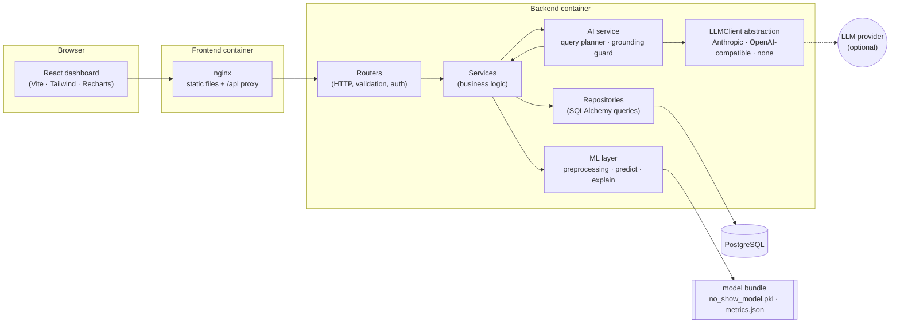
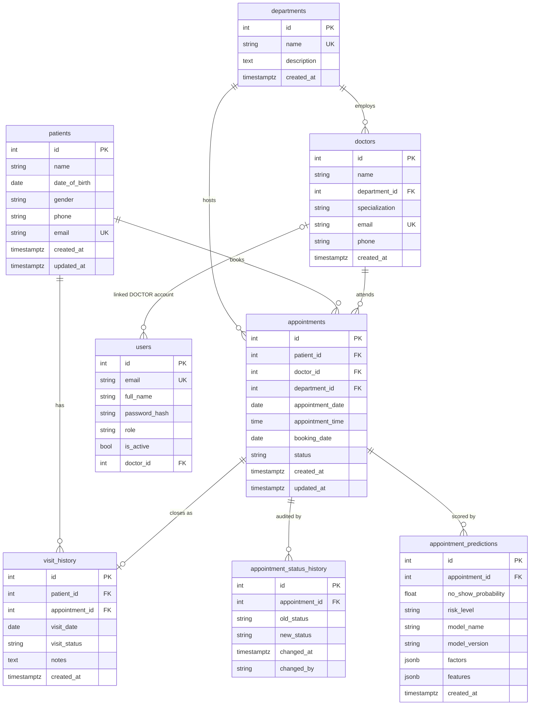
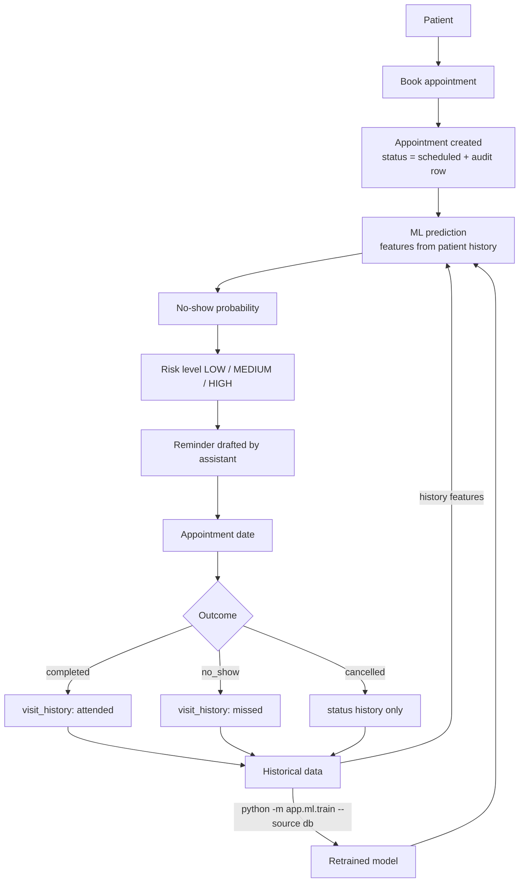
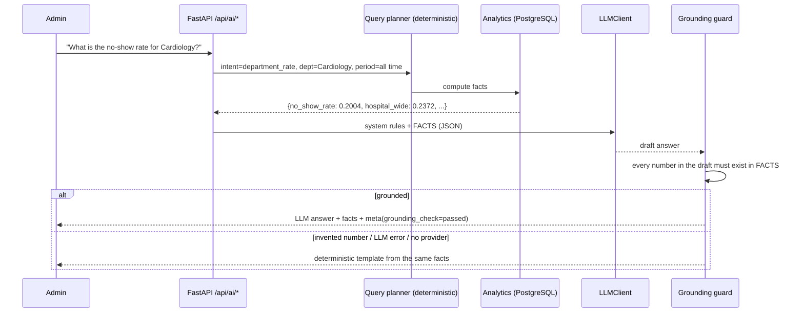

# CareSight: Healthcare Appointment No-Show Prediction System

An end-to-end hospital appointment management system. It predicts **which appointments are likely to be missed**, explains **which factors the model relied on**, and gives administrators a **grounded GenAI assistant** that drafts reminders and summarises department performance.

> **All data in this repository is synthetic.** No real patients, clinicians or hospital records are used. See [Synthetic data](#6-synthetic-training-data).

**Stack:** FastAPI · SQLAlchemy 2 · PostgreSQL 16 · Alembic · Pydantic v2 · scikit-learn · XGBoost · SHAP · React 19 + TypeScript + Vite + Tailwind + Recharts · Docker Compose · JWT + RBAC

---

## Contents

1. [Problem statement](#1-problem-statement)
2. [Features](#2-features)
3. [Architecture](#3-architecture)
4. [Database schema](#4-database-schema)
5. [Appointment flow](#5-appointment-flow)
6. [Synthetic training data](#6-synthetic-training-data)
7. [ML pipeline and feature engineering](#7-ml-pipeline-and-feature-engineering)
8. [Model comparison and evaluation](#8-model-comparison-and-evaluation)
9. [Explainability](#9-explainability)
10. [GenAI architecture](#10-genai-architecture)
11. [API documentation](#11-api-documentation)
12. [Security](#12-security)
13. [Setup: Docker (recommended)](#13-setup-docker-recommended)
14. [Setup: local development](#14-setup-local-development)
15. [Retraining the model](#15-retraining-the-model)
16. [Testing](#16-testing)
17. [Project structure](#17-project-structure)
18. [Responsible AI considerations](#18-responsible-ai-considerations)
19. [Future improvements](#19-future-improvements)

---

## 1. Problem statement

Missed appointments ("no-shows") waste clinician time, lengthen waiting lists and delay care. Many hospitals report no-show rates of 15–30%. If a hospital knows *in advance* which bookings are at risk, it can target reminders, confirmation calls or overbooking at the few appointments that need them instead of treating every patient the same way.

This project covers the whole workflow: book appointments → score no-show risk → explain the score → act on it (reminders) → record the real outcome → feed outcomes back into retraining.

## 2. Features

| Area | What you get |
|---|---|
| **Scheduling** | Patients, doctors and departments; booking with slot-conflict detection (DB-level partial unique index); rescheduling; doctor day schedules |
| **Attendance tracking** | Status state machine (`scheduled → confirmed → completed / no_show / cancelled`), immutable audit trail, visit history |
| **ML prediction** | Every booking is scored automatically; predictions are persisted with model version, features and factors |
| **Explainability** | SHAP contributions per prediction, aggregated to human-readable factors ("Previous no-shows: 3") |
| **Risk levels** | Configurable LOW / MEDIUM / HIGH bands (`RISK_LOW_MAX`, `RISK_MEDIUM_MAX`) |
| **Analytics** | Overview KPIs, department breakdown, day/week/month trends, day-of-week pattern, risk distribution, upcoming high-risk list |
| **GenAI assistant** | Prediction explanations, SMS / email / WhatsApp reminders (professional or friendly), department summaries, natural-language analytics Q&A |
| **Grounding guard** | Every LLM answer is checked against the computed facts; any invented number triggers a deterministic fallback |
| **Retraining** | CLI or admin endpoint retrains on live PostgreSQL history, then hot-reloads the model without downtime |
| **Security** | JWT auth, bcrypt hashing, ADMIN / STAFF / DOCTOR roles, doctor-scoped data, patient-contact masking |
| **Dashboard** | React admin UI: dashboard, patients, doctors, departments, appointments, appointment detail, predictions, analytics, AI assistant |

## 3. Architecture



**Layering rules (enforced throughout the code):**

- **Routers** only parse and validate HTTP input, resolve dependencies (DB session, current user, role guard) and call a service.
- **Services** hold the business rules: status transitions, slot validation, doctor scoping, grounding.
- **Repositories** are the only layer that builds SQL.
- **ML code** (`app/ml`) knows nothing about HTTP or the ORM. It works on DataFrames, so the same code runs offline (CSV) and online (DB history).
- Domain errors (`NotFoundError`, `ConflictError`, `BusinessRuleError`, …) are mapped to HTTP responses in one place (`main.py`).

## 4. Database schema



Constraints worth noting:

- `CHECK` constraints on every enum-like column (`status`, `gender`, `role`, `risk_level`, `visit_status`) and `booking_date <= appointment_date`.
- **Partial unique index** `(doctor_id, appointment_date, appointment_time) WHERE status <> 'cancelled'`. The database itself prevents double-booking a doctor, even under concurrent requests.
- Patients with appointment history cannot be deleted (`RESTRICT`), which keeps historical data intact for auditing and retraining.
- Migrations live in `backend/alembic/versions` and run automatically on container start.

## 5. Appointment flow



Every recorded outcome immediately changes the patient's history features for their *next* booking. Periodic retraining (`--source db`) also lets the model itself learn from the new outcomes.

## 6. Synthetic training data

`backend/app/ml/generate_data.py` creates **15,000 appointments for 4,600 synthetic patients** across 8 departments and 24 doctors, spanning the last 24 months plus 3 weeks of upcoming bookings. Output: `backend/data/{appointments,patients,doctors,departments}.csv`.

The generator plants **probabilistic, never deterministic** relationships:

| Signal | How it is simulated |
|---|---|
| Patient reliability | A hidden per-patient trait (never exported) shifts every appointment's log-odds, so past behaviour genuinely predicts future behaviour |
| Previous no-shows / cancellations | Add to the log-odds of the next visit (capped) |
| Booking lead time | `+0.25·log(1+lead_days)`: longer gaps are slightly riskier |
| Age, department, weekday, hour, month | Small offsets (e.g. young adults, Dermatology, Fri/Sat, late afternoon, December are riskier) |
| Noise | Gaussian noise on every appointment's log-odds |

The EDA (`python -m app.ml.eda` → `models/eda_summary.json`) confirms the planted structure is monotonic but noisy:

| Previous no-shows | 0 | 1 | 2 | 3+ |
|---|---|---|---|---|
| Observed no-show rate | 19.9% | 28.9% | 41.0% | 51.0% |

| Booking lead time (days) | 0–2 | 3–7 | 8–21 | 22–60 |
|---|---|---|---|---|
| Observed no-show rate | 18.4% | 20.8% | 25.9% | 29.9% |

The overall no-show rate is **23.7%** of attended-or-missed appointments; 8.5% of bookings are cancelled.

## 7. ML pipeline and feature engineering

`backend/app/ml/preprocessing.py` contains a **single feature function used for both training and serving**. Online, it runs over the patient's appointment history pulled from PostgreSQL, so train/serve skew is structurally impossible. This was verified: scoring the 419 upcoming appointments from the CSV and from the database gives identical risk counts (306 LOW / 102 MEDIUM / 11 HIGH).

| Feature | Type | Definition |
|---|---|---|
| `age`, `age_group` | num / cat | Age at the appointment date; bands 0-17, 18-34, 35-49, 50-64, 65+ |
| `department` | cat | Department of the appointment |
| `day_of_week`, `is_weekend` | cat / flag | Weekday of the appointment |
| `appointment_hour`, `is_morning` | num / flag | Scheduled hour; before 12:00 |
| `appointment_month` | num | 1–12 (seasonality) |
| `booking_lead_days` | num | `appointment_date − booking_date` |
| `previous_appointments` | num | Prior appointments with a known outcome |
| `previous_no_shows`, `previous_cancellations` | num | Counts over prior appointments |
| `prior_no_show_rate`, `prior_cancellation_rate` | num | Count / previous_appointments (NaN → imputed for first-timers) |
| `previous_attendance_rate` | num | completed / (completed + no-shows) |
| `days_since_last_appointment` | num | Days since the last prior appointment (capped at 730) |
| `is_first_appointment` | flag | No prior history |

**Leakage controls**

- History features use only appointments **strictly earlier** than the target, computed via cumulative sums minus the row's own flag.
- The target's own status is never a feature.
- Upcoming (scheduled/confirmed) appointments never count towards history, because their outcome is unknown.
- **Temporal split**: oldest 70% for training, next 15% for validation, most recent 15% for test. No random shuffling across time.
- Cancelled appointments are not training rows (their target is undefined), but they do count as history.

**Pipeline:** `ColumnTransformer` (median impute + standard scale for numeric features; one-hot with `handle_unknown="ignore"` for categorical ones) → classifier. The whole pipeline, the tuned decision threshold, a SHAP background sample and metadata are saved as one joblib bundle: `backend/models/no_show_model.pkl`.

## 8. Model comparison and evaluation

Three model families are trained, each with a small hyper-parameter grid:

- **Logistic Regression** (baseline)
- **Random Forest**
- **XGBoost**

Protocol:

1. Choose each family's best hyper-parameters by validation ROC-AUC.
2. Tune each family's decision threshold to maximise **no-show F1** on validation.
3. Select the family with the best validation no-show F1.
4. Refit on train + validation and report on the untouched test set.

Accuracy is never used for selection.

**Actual results** from `backend/models/metrics.json` (model version `20260930104515`; synthetic data; test set = 1,996 appointments from 2026-06-11 to 2026-09-30):

| Model | Threshold | No-show recall | No-show precision | No-show F1 | ROC-AUC | PR-AUC | Accuracy |
|---|---|---|---|---|---|---|---|
| **Logistic Regression** (selected) | 0.23 | **62.0%** | 39.1% | 0.480 | **0.684** | **0.468** | 63.3% |
| Random Forest | 0.23 | 61.5% | 38.2% | 0.471 | 0.671 | 0.446 | 62.3% |
| XGBoost | 0.23 | 64.6% | 39.2% | 0.488 | 0.676 | 0.453 | 62.9% |

Confusion matrix for the selected model on the test set (threshold 0.23): TN 925 · FP 526 · FN 207 · **TP 338**.

**Reading the results honestly**

- **Why accuracy misleads.** At the default 0.5 threshold, the same Logistic Regression scores **74.5% accuracy but catches only 11.0% of no-shows**, because the classes are imbalanced. At the tuned threshold, accuracy falls to 63% but recall rises to 62%, which is what an outreach team needs.
- **Why the baseline won.** Logistic Regression had the best *validation* F1 (0.458 vs 0.455 XGBoost vs 0.448 RF), so it was selected. XGBoost ends up marginally ahead on the *test* F1. Picking the winner from test results would leak test information, so the protocol stands. A linear model fitting best is expected here, because the synthetic generator is additive in log-odds.
- **ROC-AUC ≈ 0.68** is in the range typically reported for real-world no-show models. The problem is inherently noisy, and the synthetic data includes deliberate noise.
- **Calibration** is good in the populated range (e.g. predicted 34.5% → observed 37.2%; predicted 44.2% → observed 46.0%). This is why the LOW/MEDIUM/HIGH bands are applied to raw probabilities.
- **Drift is visible.** The test period's no-show rate (27.3%) is higher than training (23.1%), which is a good argument for scheduled retraining.

## 9. Explainability

`backend/app/ml/explain.py` computes SHAP values for every prediction:

- **Logistic Regression:** `shap.LinearExplainer` with an independent masker over a stored background sample
- **Random Forest:** `shap.TreeExplainer`
- **XGBoost:** XGBoost's native TreeSHAP (`pred_contribs=True`), which is mathematically the same as TreeExplainer and robust across library versions

Contributions from one-hot columns are **summed back to the original feature**, then formatted for people:

```json
{
  "appointment_id": 14711,
  "no_show_probability": 0.6065,
  "risk_level": "HIGH",
  "flagged_by_model": true,
  "top_factors": ["Previous no-shows: 2", "Age group: 18-34", "Booking lead time: 33 days"],
  "factors": [{"feature": "previous_no_shows", "label": "Previous no-shows", "display_value": "2",
               "contribution": 0.8533, "direction": "increases_risk"}, "..."],
  "explanation_note": "These are model factors: the historical and appointment-related signals the model relied on most for this score. They are statistical associations, not the actual reason a patient may miss an appointment."
}
```

**Model factors versus actual reasons.** The API, the UI and every assistant prompt describe factors as *what the model relied on*, never *why the patient will miss the appointment*. The model sees no information about transport, illness, work or childcare. Global importance (mean |SHAP| on the test set) is also shown on the Predictions page. In order: previous no-shows, previous appointments, age group, booking lead time.

## 10. GenAI architecture



- **Provider abstraction** (`app/services/llm_client.py`): the `LLMClient` interface has these implementations:
  - `AnthropicClient`: official `anthropic` SDK. Defaults to `claude-opus-5-5` with configurable effort, and enables server-side refusal fallback.
  - `OpenAICompatibleClient`: any Chat Completions endpoint via `LLM_BASE_URL`, e.g. OpenAI, Azure, Groq, vLLM or Ollama.
  - `none`: no external calls.

  All are configured with `LLM_PROVIDER`, `LLM_API_KEY`, `LLM_MODEL` and `LLM_BASE_URL`. Keys are never hardcoded.
- **Works without an LLM.** When `LLM_PROVIDER=none` (the default), every feature returns a deterministic answer built from the same facts, so the demo runs with zero external dependencies.
- **Features:**
  1. **Explain prediction:** the explanation may use only the stored SHAP factors.
  2. **Generate reminder:** SMS / email / WhatsApp in a professional or friendly tone. Drafts are rejected if they mention risk or predictions, omit the time or department, exceed SMS length, or contain numbers not in the appointment details.
  3. **Department summary:** statistics are computed in SQL first. Rankings ignore departments with fewer than 10 outcomes, so a 1-of-1 "100%" can't mislead anyone.
  4. **Natural-language analytics:** intents are department ranking, department rate, missed counts, day of week, trends, high-risk list, cancellations and model performance. Periods are today, yesterday, this/last week, this/last month, this year, last N days/weeks/months, or all time.
- **Privacy:** patient names and contact details are never sent to the LLM. Reminders are the one exception and use the first name only.

Example answers (template mode, real data):

> **Q:** Which day has the highest number of no-shows?
> **A:** For all recorded appointments, Monday has the most no-shows (916). By rate, Saturday is highest at 27.8%. Monday also has the most appointments, which drives its higher count.

> **Q:** How many appointments were missed this week?
> **A:** 15 appointments were missed (no-shows) at the hospital for this week (28 Sep - 04 Oct 2026), a no-show rate of 24.2%.

## 11. API documentation

Interactive Swagger UI: **http://localhost:8000/docs** (OpenAPI JSON at `/openapi.json`, which you can import into Postman). Authenticate with `POST /api/auth/login` (form fields `username`, `password`), then use the **Authorize** button.

| Method | Path | Roles | Purpose |
|---|---|---|---|
| POST | `/api/auth/login` | public | OAuth2 password flow → JWT |
| GET | `/api/auth/me` | any | Current user |
| POST / GET | `/api/auth/users` | ADMIN | Create / list staff accounts |
| POST | `/api/patients` | ADMIN, STAFF | Create patient |
| GET | `/api/patients` · `/api/patients/{id}` | any (contacts masked for DOCTOR) | List (search, paging) / detail with attendance stats |
| PUT | `/api/patients/{id}` | ADMIN, STAFF | Update |
| DELETE | `/api/patients/{id}` | ADMIN | Delete (blocked if history exists) |
| POST | `/api/doctors` | ADMIN | Create doctor |
| GET | `/api/doctors` · `/api/doctors/{id}` | any | List / detail |
| GET | `/api/doctors/{id}/schedule?date=` | any | Booked and free slots |
| POST | `/api/departments` | ADMIN | Create department |
| GET | `/api/departments` · `/api/departments/{id}` | any | List / detail |
| POST | `/api/appointments` | ADMIN, STAFF | Book (auto-scored) |
| GET | `/api/appointments` · `/api/appointments/{id}` | any (DOCTOR sees own) | Filter by status, department, doctor, patient, dates, name |
| PATCH | `/api/appointments/{id}` | ADMIN, STAFF | Reschedule / reassign (re-scored) |
| PATCH | `/api/appointments/{id}/status` | any (DOCTOR: attendance only) | Audited status change |
| POST | `/api/appointments/{id}/predict-no-show` | ADMIN, STAFF | Score + SHAP factors |
| GET | `/api/appointments/{id}/prediction` | any | Latest stored prediction |
| POST | `/api/predictions/batch` | ADMIN, STAFF | Score all upcoming appointments |
| GET | `/api/predictions/model` | any | Active model, thresholds, full metrics |
| POST | `/api/predictions/retrain` · GET `.../retrain/status` | ADMIN | Background retrain + hot reload |
| GET | `/api/analytics/overview` | any | KPIs (filters: `date_from`, `date_to`, `department_id`) |
| GET | `/api/analytics/departments` | any | Per-department stats |
| GET | `/api/analytics/no-show-trends` | any | `granularity=day\|week\|month` |
| GET | `/api/analytics/day-of-week` | any | Weekday pattern |
| GET | `/api/analytics/risk-distribution` | any | Upcoming LOW/MEDIUM/HIGH + histogram |
| GET | `/api/analytics/high-risk-upcoming` | any | Ranked upcoming risk list |
| POST | `/api/ai/explain-prediction` | ADMIN, STAFF | `{appointment_id, refresh}` |
| POST | `/api/ai/generate-reminder` | ADMIN, STAFF | `{appointment_id, channel, tone, request_confirmation}` |
| POST | `/api/ai/department-summary` | ADMIN, STAFF | `{department_id?, period, date_from?, date_to?}` |
| POST | `/api/ai/chat` | ADMIN, STAFF | `{question}` |
| GET | `/health` | public | DB + model status |

Errors are consistent: `{"detail": "...", "code": "not_found|conflict|business_rule_violation|validation_error|..."}`. Validation errors also include `errors: [{field, message}]`.

## 12. Security

- **JWT** (HS256) access tokens signed with `JWT_SECRET_KEY` (at least 32 characters, required, from the environment). Expired or tampered tokens return 401.
- **bcrypt** password hashing. Login returns the same error for an unknown user and a wrong password, to prevent account enumeration.
- **Role-based access:** ADMIN (everything, including user management and retraining), STAFF (front desk: patients, bookings, predictions, assistant), DOCTOR (own appointments only, attendance updates only, masked patient contacts, no assistant).
- **Validation:** Pydantic schemas on every payload (email format, phone pattern, date plausibility, enum values, length limits), plus DB-level `CHECK` and unique constraints.
- **No hardcoded secrets:** database credentials, JWT secret, admin bootstrap password and LLM keys all come from `.env` (see `.env.example`). `.env` is git-ignored.
- The backend container runs as a non-root user. nginx adds `X-Content-Type-Options`, `X-Frame-Options` and `Referrer-Policy` headers.

## 13. Setup: Docker (recommended)

Requirements: Docker with Compose v2.

```bash
cp .env.example .env
# edit .env: set POSTGRES_PASSWORD, JWT_SECRET_KEY, FIRST_ADMIN_PASSWORD
#   python -c "import secrets; print(secrets.token_urlsafe(48))"   # for JWT_SECRET_KEY
# optional: DEMO_USERS_PASSWORD, LLM_PROVIDER / LLM_API_KEY

docker compose up --build
```

| Service | URL |
|---|---|
| Dashboard | http://localhost:3000 |
| API / Swagger | http://localhost:8000/docs |
| PostgreSQL | localhost:5432 |

On first start, the backend container automatically does the following:

1. Runs Alembic migrations.
2. Generates the synthetic dataset if it is missing.
3. Trains a model if none is present. A pre-trained artifact ships in `backend/models/`.
4. Loads the synthetic data, creates the admin (and optional demo) accounts, and scores upcoming appointments.

Sign in with `FIRST_ADMIN_EMAIL` / `FIRST_ADMIN_PASSWORD`. If `DEMO_USERS_PASSWORD` is set, `staff@citygeneral.org` and `doctor@citygeneral.org` are also created.

Useful commands:

```bash
docker compose logs -f backend
docker compose exec backend python -m app.ml.train --source db    # retrain on live data
docker compose exec backend python -m app.scripts.seed --reset    # wipe and reload synthetic data
docker compose down -v                                           # remove containers and volumes
```

Retrained models are stored in the `model_data` volume, so they survive rebuilds. Run `docker compose down -v` to go back to the shipped model.

## 14. Setup: local development

Requirements: Python 3.12, Node 20.19+ (or 22+), and a PostgreSQL 16 instance. The easiest option is `docker compose up -d postgres`.

```bash
cp .env.example .env            # POSTGRES_HOST=localhost

# Backend
cd backend
python3.12 -m venv .venv && source .venv/bin/activate
pip install -r requirements.txt
alembic upgrade head
python -m app.ml.generate_data   # optional: regenerate synthetic CSVs
python -m app.ml.eda             # optional: EDA summary -> models/eda_summary.json
python -m app.ml.train           # train + compare models -> models/
python -m app.scripts.seed       # load data, create users, score upcoming appointments
uvicorn app.main:app --reload --port 8000

# Frontend (new terminal)
cd frontend
npm install
npm run dev                      # http://localhost:5173 (proxies /api to :8000)
```

**Enabling a real LLM**

```bash
# Anthropic (official SDK; default model claude-opus-5-5)
LLM_PROVIDER=anthropic
LLM_API_KEY=sk-ant-...
LLM_EFFORT=medium

# Groq (OpenAI-compatible) - verified working with openai/gpt-oss-120b
LLM_PROVIDER=openai
LLM_API_KEY=gsk_...
LLM_MODEL=openai/gpt-oss-120b
LLM_BASE_URL=https://api.groq.com/openai/v1
LLM_MAX_TOKENS=4000

# Any other OpenAI-compatible endpoint
LLM_PROVIDER=openai
LLM_API_KEY=...
LLM_MODEL=gpt-4o-mini
LLM_BASE_URL=https://api.openai.com/v1
```

## 15. Retraining the model

```bash
python -m app.ml.train --source csv   # synthetic CSV (reproducible benchmark)
python -m app.ml.train --source db    # every appointment currently in PostgreSQL
```

You can also use the dashboard: **Predictions → Retrain from live data** (ADMIN). This calls `POST /api/predictions/retrain`, which runs one background job at a time, writes the artifact atomically and hot-reloads the model, with no restart needed. Every prediction stores its `model_version`, so scores remain traceable across retrains.

## 16. Testing

An automated test suite is **not included yet**; it was deliberately left out of this iteration. Each phase was verified manually against the running system:

- CRUD, validation errors, 404s, slot conflicts, invalid status transitions, delete protection
- RBAC with ADMIN / STAFF / DOCTOR accounts (403s, doctor scoping, contact masking, tampered-token rejection)
- Analytics endpoints cross-checked against independent pandas calculations on the CSV (all rates matched exactly)
- Train/serve parity (identical risk counts from CSV and DB features; identical metrics when retraining from the DB)
- The grounding guard, with a stub LLM that invents numbers (rejected → template) and one that leaks risk into a reminder (rejected)
- The Anthropic request shape, via a local mock server
- UI flows in headless Chrome (booking → auto-prediction → AI explanation → reminder → chat), desktop and mobile widths

The planned Pytest suite is listed under [Future improvements](#19-future-improvements).

## 17. Project structure

```text
.
├── docker-compose.yml · .env.example · README.md
├── backend/
│   ├── Dockerfile · docker-entrypoint.sh · requirements.txt · alembic.ini
│   ├── alembic/versions/            # migrations
│   ├── data/                        # SYNTHETIC CSVs
│   ├── models/                      # no_show_model.pkl · metrics.json · eda_summary.json
│   └── app/
│       ├── main.py                  # app factory, middleware, error handlers
│       ├── core/                    # config, security (JWT/bcrypt), dependencies, exceptions, logging
│       ├── db/                      # engine/session, declarative base
│       ├── models/                  # SQLAlchemy ORM models + enums
│       ├── schemas/                 # Pydantic request/response models
│       ├── repositories/            # SQL access (incl. analytics aggregates)
│       ├── services/                # business logic, prediction, analytics, AI, LLM client, NL planner
│       ├── routers/                 # auth, patients, doctors, departments, appointments, predictions, analytics, ai_assistant
│       ├── ml/                      # generate_data, eda, preprocessing, train, evaluate, predict, explain, dataset
│       └── scripts/                 # seed, create_admin
└── frontend/
    ├── Dockerfile · nginx.conf · vite.config.ts
    └── src/
        ├── components/              # layout, UI kit, prediction & reminder panels, charts/
        ├── pages/                   # Dashboard, Patients, Doctors, Departments, Appointments,
        │                            # AppointmentDetail, Predictions, Analytics, Assistant, Login
        ├── services/                # typed API client, formatting, periods
        ├── hooks/                   # auth context, async loader, chart colors
        └── types/
```

## 18. Responsible AI considerations

- **Risk scores support care; they don't decide it.** A HIGH score should trigger *more support* (a reminder, a call, a reschedule offer), never denial of care or deprioritisation.
- **Model factors are not reasons.** The factors are associations in historical data. Every explanation says so, and the assistant is instructed never to claim to know why a patient will miss an appointment.
- **Patients never see their score.** Reminder drafts are rejected if they mention risk, predictions or history.
- **Fairness.** The model uses age group and department but deliberately excludes gender. Before real-world use, audit calibration and error rates across age groups and other protected characteristics. Also check proxy effects: "previous no-shows" can reflect transport or socioeconomic barriers, and the right response to that is support.
- **Data minimisation.** Patient records store only scheduling essentials. Doctors see masked contact details. The LLM never receives names or contacts (reminders get the first name only).
- **Grounded GenAI.** Numbers come from SQL; LLM output is verified against the facts and replaced by a template when it doesn't match. The UI shows whether an answer came from the LLM or the fallback.
- **Traceability.** Every prediction is stored with its model version, inputs and factors. Every status change is audited with who made it and when.
- **Synthetic data.** The metrics in this README describe the pipeline on synthetic data, not clinical performance. A real deployment needs validation on local data, drift monitoring and governance sign-off.

## 19. Future improvements

- **Automated tests:** a Pytest suite covering CRUD, status transitions, prediction (including invalid IDs), preprocessing leakage, risk classification, analytics calculations, AI endpoint validation and authentication, plus Vitest/Playwright tests for the UI and a CI pipeline.
- Probability calibration (isotonic / Platt) and per-department thresholds; cost-sensitive threshold selection based on outreach capacity.
- Scheduled retraining with drift detection (feature and label drift), plus a model registry with champion/challenger evaluation.
- Real reminder delivery (SMS/email provider integration) with delivery tracking, and reminder-sent as a feature, measured by an A/B test of the intervention's effect.
- Richer features: weather, public holidays, distance to hospital, reminder history, appointment type (new vs follow-up).
- Refresh tokens, account lockout, audit logs for data access, and field-level encryption for contact data.
- Fairness dashboard: subgroup calibration and recall.
- Streaming LLM responses and multi-turn conversational context in the assistant.
